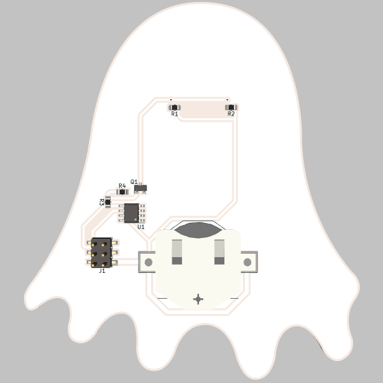
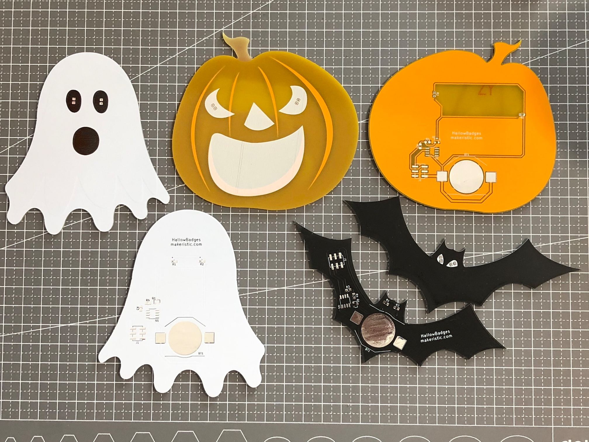

# HallowBadges-Ghost

Ghost-shaped Halloween PCB badge with two flashing LEDs, an ATtiny13A microcontroller and CR2032 coin-cell power. Designed by Michael Cutler in 2020, with KiCad source, fabrication files and an Arduino example.

**Status:** Boards were manufactured by [JLCPCB](https://jlcpcb.com/). The firmware example now compiles with the toolchain below. The hardware audit found remaining fabrication and assembly issues: review the [audit report](docs/code-audit-report.md) before a new manufacturing run.

* The original project reported about 6 days / 144 hours from one CR2032 battery; runtime depends on the LEDs, firmware and battery.
* The board also features an optional surface-mount 2.54mm connector which is [Simple Add-ons (SAO)](https://hackaday.io/project/175182-simple-add-ons-sao) compatible so you can power the badges externally.
* You can program the device using a [SOIC-8 Test Clip](https://www.digikey.com/en/products/detail/mueller-electric-co/BU-P5250/9675948) or similar, I attached it to an Arduino-as-ISP setup.

Render of the Front:


Render of the Back:



The finished product:



## Video

I've uploaded a quick video of the boards in action here:

[](https://www.youtube.com/watch?v=xT_LtK2wgpI)

## Hardware

The two-layer PCB uses an ATtiny13A-SSU in SOIC-8, two 0805 LEDs, a BSS138 MOSFET and 0805 resistors. The optional SAO connector is a surface-mount 2×3 header on 2.54 mm pitch.

### Files and fabrication

* [Schematic PDF](HallowBadges-schematic.pdf) — view the circuit without installing KiCad.
* [Bill of materials](HallowBadges-BOM.csv) — references, footprints and datasheet links.
* [KiCad project](HallowBadges.pro), [schematic](HallowBadges.sch) and [PCB layout](HallowBadges.kicad_pcb) — editable source.
* [Legacy schematic symbol cache](HallowBadges-cache.lib) — complete KiCad 5.1.7 symbol definitions for loading the schematic independently of global symbol libraries.
* [Gerber and drill files](gerber/) — original manufacturing exports, including a Gerber job file.
* [Custom outline footprint](HallowBadges.pretty/) — the ghost artwork and board outline.
* [Images](images/) and [component references](datasheets/) — photographs, renders and reference material.
* [Arduino sketch](firmware/HallowBadges/HallowBadges.ino) — the flashing-LED example.

The board and Gerber job headers identify **KiCad 5.1.7**. Open `HallowBadges.pro` and keep `HallowBadges-cache.lib` beside the schematic. The restored cache supplies all seven symbol definitions from the pinned KiCad 5.1.7 libraries; [provenance and upstream terms](THIRD_PARTY.md) are included. The project [footprint library table](fp-lib-table) registers `HallowBadges.pretty` as `HallowBadges`; keep that directory beside the project. Standard KiCad footprint and 3D libraries are still needed for library updates and complete renders. If using a newer KiCad release, migrate a copy and inspect the converted schematic, footprints and design rules before regenerating outputs.

The files in `gerber/` are the historical 2020 manufacturing exports. The editable PCB and custom footprint have since had two zero-length outline segments removed; their nonzero contour, copper and connectivity are unchanged. Review the remaining DRC findings in the [audit report](docs/code-audit-report.md), then regenerate and inspect manufacturing outputs before a new run. The historical exports have not been replaced by unchecked nightly-KiCad output.

For assembly, check component polarity and confirm component values before ordering. The existing BOM uses generic `R_Small` resistor values and `LED_Small` LED entries, so it is not a complete procurement list.

H1 and H2 appear in the schematic and BOM but have no footprints on this PCB. The coin-cell and SAO supply share VCC directly, with no source isolation: remove the coin cell before applying external power or powering the board from an ISP programmer. J1 is an SAO connector, not a six-pin ISP connector.

I created three designs, each can be found on Github:

* [HallowBadges-Bat](https://github.com/makeristic/HallowBadges-Bat)
* [HallowBadges-Ghost](https://github.com/makeristic/HallowBadges-Ghost)
* [HallowBadges-Pumpkin](https://github.com/makeristic/HallowBadges-Pumpkin)


## Software

The [downloadable Arduino sketch](firmware/HallowBadges/HallowBadges.ino) blinks both LEDs together through Q1. It uses the `randomSeed` and `random` APIs supported by [MicroCore 2.5.2](https://github.com/MCUdude/MicroCore/tree/v2.5.2). The original `tiny_srandom` and `tiny_random` names were not defined by that core.

`GPIO1` is PB0 / OC0A (physical SOIC pin 5), so `PIN_PB0` selects the hardware PWM output driving Q1 through R3. `A3` is the unused PB3 input (physical pin 2). The mapping follows the [MicroCore pin definitions](https://github.com/MCUdude/MicroCore/blob/v2.5.2/avr/variants/attiny13a/pins_arduino.h) and the [ATtiny13A datasheet](https://ww1.microchip.com/downloads/en/DeviceDoc/ATtiny13A-Data-Sheet-DS40002307A.pdf).

Compile from the repository root with Arduino CLI:

```sh
arduino-cli core update-index --additional-urls https://mcudude.github.io/MicroCore/package_MCUdude_MicroCore_index.json
arduino-cli core install MicroCore:avr@2.5.2 --additional-urls https://mcudude.github.io/MicroCore/package_MCUdude_MicroCore_index.json
arduino-cli compile --fqbn MicroCore:avr:13:clock=1M2,BOD=disabled,eeprom=keep,bootloader=no_bootloader --warnings all firmware/HallowBadges
```

This configuration was compile-checked with Arduino CLI 1.5.1 and AVR GCC 7.3.0. It is a 1.2 MHz, no-bootloader build configuration; compiling does not program fuses. The original boards' clock and fuse settings were not recorded, so confirm that the actual clock matches the selected build before programming.

The original boards were programmed with Arduino-as-ISP and a SOIC-8 clip. ISP requires RESET (pin 1), MOSI (pin 5), MISO (pin 6), SCK (pin 7), VCC (pin 8) and GND (pin 4). Verify clip orientation and power before connection. The updated sketch has not been uploaded to a physical badge.

## Licence

This work retains its existing [Creative Commons Attribution-ShareAlike 4.0 International licence](https://creativecommons.org/licenses/by-sa/4.0/). The full text is in [LICENSE](LICENSE). Attribute Michael Cutler / Makeristic and preserve the licence when sharing adaptations.

Third-party component datasheets, pinout reference images and KiCad library material retain their respective owners' rights and notices; the project licence does not relicense those materials. The restored symbol cache is covered by the upstream [KiCad library licence and electronic-design exception](LICENSE-KiCad.md), with attribution and source details in [THIRD_PARTY.md](THIRD_PARTY.md).

## Questions and contributions

Use [GitHub Issues](https://github.com/makeristic/HallowBadges-Ghost/issues) for questions, build reports or design problems. Include the repository revision, KiCad version and relevant photos or measurements. Pull requests should explain the change and keep editable source and regenerated manufacturing outputs consistent. For a documentation-only change, leave manufacturing files unchanged.
